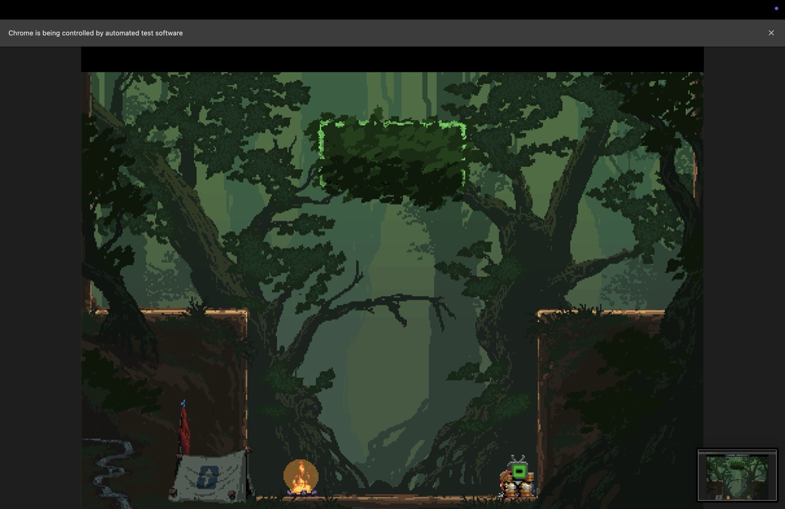

# Jump King RL

A reinforcement-learning agent learning to climb *Jump King*. It trains with **PPO + Random Network Distillation (RND) + Self-Imitation Learning (SIL)** on an open-source p5.js version of the game, driven through a headless browser, with 16 agents sharing one browser tab.



📝 **Full write-up:** [Teaching an AI to Climb Jump King](blog/jump-king-rl.md). It covers the objectives, model choice, roadblocks, and open problems.

## How it works

```
Python trainer (PyTorch)  ── actions for 16 agents ──►  Selenium  ──►  Headless Chrome
  PPO + RND + SIL agent                                                  p5.js Jump King
  JumpKingEnv_Multi (Gymnasium)  ◄── 16 × 10 floats of game state ───   (draw loop paused)
```

- **No real-time play.** Training calls p5.js's `noLoop()` and steps physics directly with `player.Update()`. One environment step equals 4 physics frames.
- **State comes from memory, not pixels.** Each step reads the player objects' fields directly from the game.
- **One round trip per step.** All 16 agents' actions go into the browser in a single `execute_script` call, and all their states come back in one array.
- **The game's own population code holds the agents.** Code Bullet's genetic-algorithm population is reused to hold the RL agents, and an `rlRenderMode` flag draws them.

### Observation: 9 floats per agent

Each feature is divided by a fixed game constant, so all inputs are roughly on the same scale.

| Feature | Source in the game |
|---|---|
| `x`, `y` | `player.currentPos` |
| `vx`, `vy` | `player.currentSpeed` |
| `is_grounded` | `player.isOnGround` |
| `jump_timer` | frames of jump charge held (0–30) |
| `facing_right` | `player.facingRight` |
| `level` | `player.currentLevelNo` (0–42) |
| `global_height` | `player.GetGlobalHeight()` |

### Actions: 6 discrete

| # | Action |
|---|---|
| 0 | idle |
| 1 | walk left |
| 2 | walk right |
| 3 | charge jump (straight up) |
| 4 | charge jump (left) |
| 5 | charge jump (right) |

A jump fires when the agent switches from a charge action (3–5) to a non-charge action (0–2), which mirrors holding and releasing the jump button.

### Reward

Potential-based reward shaping ([Ng, Harada & Russell, 1999](https://people.eecs.berkeley.edu/~pabbeel/cs287-fa09/readings/NgHaradaRussell-shaping-ICML1999.pdf)) on height, plus a small time penalty and a bonus for reaching the princess:

```
r = γ·Φ(s′) − Φ(s)  −  0.001  (+10 on reaching the princess)
Φ(s) = global_height / 900          # measured in "levels climbed"
```

The shaping term rewards *net* progress, so climbing up and falling back down nets roughly zero. That closes an exploit an earlier reward allowed.

### Model

| Component | Role |
|---|---|
| [PPO](https://arxiv.org/abs/1707.06347) | Stable on-policy actor-critic. Ported from [CleanRL](https://docs.cleanrl.dev/rl-algorithms/ppo-rnd/)'s `ppo_rnd_envpool.py`. |
| [RND](https://arxiv.org/abs/1810.12894) | Curiosity bonus for reaching unfamiliar states, with a separate value head for intrinsic reward |
| [SIL](https://proceedings.mlr.press/v80/oh18b.html) + [PER](https://arxiv.org/abs/1511.05952) | Replays the agent's own better-than-expected actions from a prioritized buffer |

Network: a shared `9 → 256 → 256` trunk, an actor head (`256 → 256 → 6`), and two critic heads (extrinsic and intrinsic) on a residual feature layer. Hyperparameters live in [`configs/ppo_rnd.yml`](configs/ppo_rnd.yml).

## Project structure

```
configs/ppo_rnd.yml                  Hyperparameters (loaded by utilities/Args.py)
environment/jump_king_env.py         Gymnasium envs: single-agent and 16-agent vectorized, PBRS reward
models/PPO/ppo_rnd_envpool_SIL.py    Current trainer: PPO + RND + SIL
models/PPO/ppo_rnd_envpool.py        Earlier trainer: PPO + RND
utilities/Args.py                    Config dataclass + YAML loader
utilities/Memory.py                  Prioritized replay buffer for SIL
utilities/VideoStreamer.py           Streams training clips to mp4 / W&B
server/main.py                       Local game server + Selenium/Chrome launcher
modal/main.py                        Cloud training job on Modal (T4 GPU)
tests/                               pytest suite: mocked reward math + browser smoke tests
eval.py                              Watch a checkpoint play (outdated, see Status)
game/                                p5.js game, a fork of Code Bullet's Jump-King
blog/                                Project write-up and figures
```

## Getting started

### 1. Clone the project and the game

The `game/` folder is a git submodule pinned to [rkv-freelancer/Jump-King](https://github.com/rkv-freelancer/Jump-King), so clone recursively:

```bash
git clone --recurse-submodules https://github.com/rkv-freelancer/AI-Plays-Jump-King.git
cd AI-Plays-Jump-King
```

If you already cloned without `--recurse-submodules`, fetch the game with:

```bash
git submodule update --init
```

### 2. Create the environment

You need Google Chrome installed. Selenium downloads a matching chromedriver automatically.

```bash
conda env create -f environment.yml
conda activate jump_king_rl--personal_proj
```

### 3. Train locally

Run from the project root. The config sets `track: true`, so run `wandb login` first, or set `track: false` in `configs/ppo_rnd.yml`.

```bash
python models/PPO/ppo_rnd_envpool_SIL.py
```

Checkpoints are written to `checkpoints/`, and TensorBoard logs to `runs/`.

### 4. Train on Modal (cloud GPU)

```bash
pip install modal
modal token new
modal secret create wandb-secret WANDB_API_KEY=<your-key>
modal run modal/main.py
```

When the job finishes, download the checkpoints:

```bash
modal volume get jump-king-checkpoints checkpoints/ ./checkpoints
```

### 5. Run the tests

```bash
python tests/main.py              # mocked tests only, no browser (~1 s)
python tests/main.py --browser    # include browser smoke tests (~30 s)
```

## Status

**Working:** a 16-agent vectorized environment, PBRS reward with unit tests, PPO + RND + SIL training on Modal, W&B logging (per-episode max level, jump releases, per-action frequencies), and automatic training videos.

**Open issues** (details in the [write-up](blog/jump-king-rl.md#roadblocks-im-still-working-on)):

- The agent rarely discovers fully charged jumps.
- Timeouts are treated as terminal states when computing advantages.
- Extrinsic rewards aren't normalized, but intrinsic rewards are.
- The SIL buffer stores every transition instead of only the best episodes.
- Checkpoints save only the agent's weights, not the RND or normalizer state.
- Go-Explore save/restore is built into the environment but not wired into the trainer.
- `eval.py` predates the vectorized environment and needs updating before it can load new checkpoints.

## Roadmap

1. Bootstrap correctly on timeouts and normalize extrinsic rewards.
2. Save full training state in checkpoints, and update `eval.py`.
3. Filter SIL to full-episode, new-best trajectories.
4. Try macro-actions ("charge for *k* steps, then release") and sticky actions for jumping.
5. Wire up Go-Explore restarts from archived states.
6. Benchmark against Code Bullet's genetic algorithm on the same build of the game.

<details>
<summary><strong>Original plan (April 2025)</strong></summary>

The project started as an imitation-learning project. That plan was parked in favor of PPO + RND, but it's kept here for reference.

#### Approach

Train with reinforcement learning and imitation learning:

- [Sample Efficient Actor-Critic with Experience Replay (ACER)](https://arxiv.org/abs/1611.01224): on/off-policy learning
- [Deep Q-learning from Demonstrations (DQfD)](https://arxiv.org/abs/1704.03732): pre-training from human demonstrations

**Encode each video/round as experiences:**

```
Game UI          -> Adapter
Game Engine (JS) -> Adapter
Adapter -> Game State (Selenium) -> RL Environment (Python) + RL Agent (Python)
```

#### Agenda

1. Record a modest amount of human gameplay (10–20 successful runs).
2. Pre-train the policy network with behavioral cloning.
3. Fine-tune with RL.

#### Planned state representation

| Variable | Type | Description |
|---|---|---|
| `Position_X` | float | Current x position |
| `Position_Y` | float | Current y position |
| `Velocity_X` | float | Current x velocity |
| `Velocity_Y` | float | Current y velocity |
| `Is_Grounded` | bool | Whether the player is on solid ground (can jump or walk) |
| `Is_Charging` | bool | Whether the player is charging a jump |
| `Charge_Time` | float | How long the jump has been charging (0 if not charging) |
| `Wall_Left` | float | Distance to the nearest wall/obstacle on the left (or a binary collision flag) |
| `Wall_Right` | float | Distance to the nearest wall/obstacle on the right |
| `Wall_Up` | float | Distance to the ceiling/platform above |
| `Wall_Down` | float | Distance to the floor below (0 if grounded) |
| `Map_Position` | int | Optional zone/section identifier for tracking progress |

#### Planned action space

```
Action_Type:   int  # 0: no action, 1: walk left, 2: walk right, 3: start charging jump, 4: release jump
Direction_Key: int  # 0: none, 1: left, 2: right (applied while charging or walking)
```

#### Demonstrations to record

A script would record these from human gameplay:

| Field | Type | Description |
|---|---|---|
| `Key_Pressed` | list[bool] | `[Left, Right, Jump]` |
| `Key_Duration` | float | How long jump was held (jumps only) |
| `Direction_During_Charge` | int | 0: none, 1: left, 2: right |

#### Candidate networks

- **Feed-forward policy network:** input layer (state) → hidden layers → output layer (action probabilities)
- **Dueling DQN:** input layer → shared feature layers → [value stream + advantage stream] → Q-values

#### Next steps (as of 2025)

- Connect to Modal for cloud GPU training.
- Train PPO on Jump King.

</details>

## Credits

- **Jump King** is the original game by Nexile.
- **[Code Bullet](https://github.com/Code-Bullet/Jump-King)** wrote the p5.js recreation this project's environment is built on.
- **[CleanRL](https://github.com/vwxyzjn/cleanrl)** (Huang et al., 2022) provided the reference PPO + RND implementation. See [`CITATION.cff`](CITATION.cff) for the full list of references.

## License

The code in this repository is released under the [MIT License](LICENSE). The `game/` submodule and the *Jump King* artwork and sounds are **not** covered by it. See [`THIRD_PARTY_NOTICES.md`](THIRD_PARTY_NOTICES.md) for the CleanRL license and details on the game.
