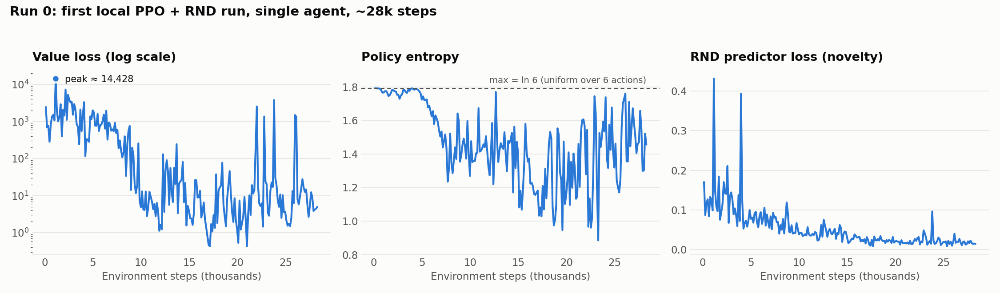
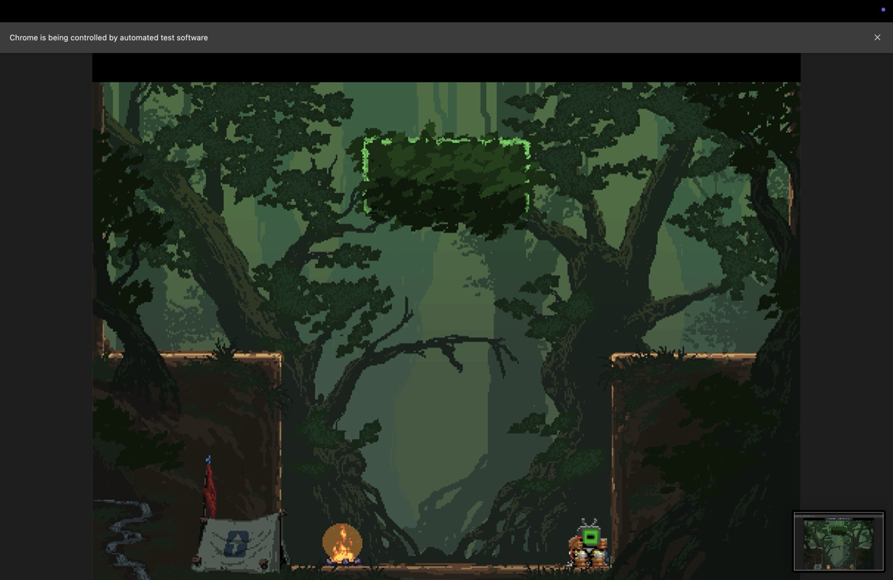

<!--
ASSET CHECKLIST (this comment does not render; delete it before publishing)
Already in ./assets:
  [x] run0-diagnostics.png           built from the local TensorBoard log of the first training run
  [x] level0-agent-pinned-right.jpg  screenshot from my notes: early agent stuck against the right wall
Export from W&B and drop in (or point these paths at your hosted copies):
  [ ] assets/videos/training-early.mp4      a "video/training" clip from an early update
  [ ] assets/videos/training-latest.mp4     a "video/training" clip from the latest run
  [ ] assets/videos/newlevel-best.mp4       the "video/new_level" clip for the highest level reached
  [ ] assets/wandb-return-exploit.png       charts/episodic_return from the run that hit ~63k (pre-PBRS)
  [ ] assets/wandb-max-level.png            charts/episodic_max_level from the latest run
  [ ] assets/wandb-action-freq.png          actions/freq_* (stacked or overlaid) from the latest run
Fill in the "[TODO: ...]" values in the "Current playthroughs" table.
If your site can't embed <video>, convert the clips to GIF/WebM or link to the W&B report.
-->

# Teaching an AI to Climb Jump King

**TL;DR:** I'm training a reinforcement-learning (RL) agent to beat *Jump King*, a game known for wiping out minutes of progress with one bad jump. The agent controls a JavaScript version of the game through a headless browser. It learns with **PPO** plus **Random Network Distillation** (a curiosity bonus) and **Self-Imitation Learning**, and it trains 16 copies of itself inside one browser tab on a cloud GPU. Along the way it found a reward exploit worth about 63,000 points in a game where the honest maximum is about 38,700. It also refused to jump, and it crashed Chrome more than once. This post covers the design, why I chose this model, what I've fixed, and what's still broken.

---

## Why Jump King?

Jump King's controls are simple. You hold a button to charge a jump and release it to leap. You can't steer in mid-air, you bounce off walls, and one missed landing can drop you several screens. The tower is 43 screens tall, and the princess waits at the top.

Those rules make it a hard RL problem:

- **Sparse reward.** The only real goal is at the very top.
- **Compound actions.** A jump isn't one button press. It's "hold for *N* frames, then let go," and *N* decides whether you land or fall.
- **Expensive mistakes.** One bad jump can undo minutes of progress, so random exploration is costly.
- **Deterministic physics.** The game is predictable enough that an agent can just memorize a route, which isn't the same as learning to play.

[Code Bullet](https://github.com/Code-Bullet/Jump-King) famously trained a genetic algorithm to climb it and open-sourced his p5.js recreation of the game. His AI's "brain" is a fixed list of planned moves (`jump? / hold time / direction`) that evolves over generations. It never looks at the screen. It replays a route that worked. I wanted the opposite: a **closed-loop policy** that looks at where the character is and decides what to do next.

## Objectives

1. **Learn a reactive policy, not a memorized route.** Every decision depends on the current game state.
2. **Reach the princess.** Success means landing in the princess zone on the final level (level 43; index 42 in code).
3. **Use a hobby budget.** Train on a single T4 GPU in the cloud, not a cluster.
4. **Make every failure diagnosable.** Structured logs, training videos, per-action histograms, and unit tests for the reward math.
5. **Learn the stack from first principles.** Every component should trace back to a paper I've actually read.

## Project scope

| In scope | Out of scope (for now) |
|---|---|
| Code Bullet's open-source p5.js recreation as the environment | The commercial game and its DLC |
| Observations read directly from game memory (9 numbers) | Learning from pixels with a CNN |
| 6 discrete actions that mirror the real controls | Analog or continuous control |
| The PPO family plus exploration add-ons (RND, SIL, Go-Explore) | Imitation learning from human demos (my original 2025 plan, parked) |
| Cloud training on Modal, tracking on Weights & Biases | Distributed training across multiple machines |
| A test suite for the environment contract and reward math | Real-time play speed during training |

## Timeline

| When | Milestone |
|---|---|
| Apr 2025 | Repo started. Sketched the state representation and vendored Code Bullet's game. The plan was behavioral cloning from 10–20 of my own runs, then RL fine-tuning. |
| May 23–25, 2026 | Picked it back up. Built the Python ↔ browser bridge (local HTTP server + Selenium), wrapped it as a Gymnasium environment, and ported CleanRL's PPO + RND. First local training run. |
| May 26 | Princess success zone, termination logic, and cloud training on Modal. |
| May 27 | Found the reward exploit. Switched to potential-based reward shaping and added tests. |
| May 28 | Training video capture. |
| May 31 – Jun 2 | Vectorized environment: 16 agents in one browser tab. |
| Sep 6 | Self-Imitation Learning with prioritized replay, streaming video, Chrome hardening. |
| Sep 26 (in progress) | Rescaled rewards and observations; save/restore of game state for Go-Explore. |

---

## How the system works

```
┌───────────────────────── Modal container (T4 GPU, 16 GB RAM) ──────────────────────────┐
│                                                                                         │
│   Python trainer (PyTorch)                        Headless Chromium                     │
│   ┌───────────────────────────┐  execute_script  ┌──────────────────────────────────┐   │
│   │ PPO + RND + SIL agent     │ ───────────────► │ p5.js Jump King, draw loop paused │   │
│   │ JumpKingEnv_Multi (gym)   │ ◄─────────────── │ Population of 16 Player objects   │   │
│   └────────────┬──────────────┘  (16 × 10) floats└──────────────────────────────────┘   │
│                │                                     ▲ served by a local http.server    │
│                ▼                                                                        │
│   checkpoints → Modal Volume           metrics + videos → Weights & Biases              │
└─────────────────────────────────────────────────────────────────────────────────────────┘
```

Four design decisions shape everything else:

- **The game doesn't run in real time.** During training I call p5.js's `noLoop()` to stop the draw loop, and Python advances physics by calling `player.Update()` directly. One environment step equals 4 physics frames. The game runs as fast as JavaScript can compute it, and the canvas is only drawn when a video is recording.
- **State comes from memory, not pixels.** Each step reads 10 numbers per player straight from the game's JavaScript objects.
- **One round trip per step, for all agents.** Actions for all 16 agents go into the browser as four boolean arrays in one `execute_script` call. All states come back as one flat `Float32Array`. The Selenium round trip is the most expensive part of a step, so batching makes each one return 16 transitions instead of 1.
- **The game's own population code holds my agents.** Code Bullet's code already manages a population of players for his genetic algorithm. I reuse it to hold 16 RL agents and added an `rlRenderMode` flag so the canvas draws my agents instead of his 600.

### What the agent sees

The 9 observation features, each divided by a known game constant so they all sit at roughly the same scale:

| Feature | Source in the game | Divided by |
|---|---|---|
| `x`, `y` | `currentPos` | canvas width (1200) / screen height (900) |
| `vx`, `vy` | `currentSpeed` | max jump speed (22) |
| `is_grounded` | `isOnGround` | already 0/1 |
| `jump_timer` | frames of charge held (0–30) | 30 |
| `facing_right` | `facingRight` | already 0/1 |
| `level` | `currentLevelNo` (0–42) | 43 |
| `global_height` | `GetGlobalHeight()` | 43 × 900 |

### What the agent can do

| # | Action |
|---|---|
| 0 | idle |
| 1 | walk left |
| 2 | walk right |
| 3 | charge jump (straight up) |
| 4 | charge jump (left) |
| 5 | charge jump (right) |

A jump **fires when the agent switches from a charge action to a non-charge action**, which mirrors holding and releasing the button. How long the agent stays in actions 3–5 decides how far the jump goes.

---

## Choosing the model

I considered several approaches before writing any training code:

| Approach | What it's good at | Why I didn't pick it (yet) |
|---|---|---|
| Genetic algorithm (Code Bullet's approach) | Proven on this exact game | Open-loop: it memorizes a move list and ignores state |
| Behavioral cloning from my own play (the original 2025 plan) | Fast start if good demos exist | Needs recording tooling and many clean runs, and copies my mistakes |
| DQN / Dueling DQN | Sample-efficient thanks to replay | Explores with ε-greedy, which almost never strings together a long charged jump |
| ACER | Mixes on- and off-policy learning | More moving parts and fewer maintained reference implementations |
| **PPO** ✅ | Stable, well understood, has an excellent single-file reference ([CleanRL](https://docs.cleanrl.dev/rl-algorithms/ppo-rnd/)) | On-policy, so it forgets rare good runs. SIL fixes that. |
| **+ RND** ✅ | A curiosity bonus designed for sparse, hard-exploration games | The novelty signal fades quickly in a small state space |
| **+ SIL** ✅ | Replays the agent's own better-than-expected moves | Added in September 2026 |
| Go-Explore ⏳ | Built for "one mistake sends you back" games | Needs save/restore of game state, which is scaffolded but not wired up |

**Why PPO + RND?** Jump King has the same profile as *Montezuma's Revenge*: sparse reward, long horizon, and a single mistake costs a lot of progress. That game is exactly the benchmark RND was built to crack. CleanRL also ships a single-file `ppo_rnd_envpool.py` that I could read line by line, annotate, and port.

**Why add SIL?** The genetic algorithm has one thing PPO lacks: it *remembers its best individuals*. PPO throws away each batch after one update, so a lucky run that reaches a new level is used once and then forgotten. Self-Imitation Learning keeps a replay buffer of states, actions, and returns. It nudges the policy toward actions whose actual return beat the critic's prediction, `(R − V(s))₊`, and never learns from below-expectation outcomes.

**Why a state vector instead of pixels?** The 9 numbers above fully describe the game state. A CNN over 1200×950 frames would spend far more compute to recover the same information. A small MLP trains fine on a T4, or even on a laptop.

### Network architecture

```
obs (N, 9)
  └─ trunk:          9 → 256 → 256 (ReLU)
       ├─ actor:     256 → 256 → 6 action logits
       └─ extra:     256 → 256, added back onto the trunk (residual)
             ├─ critic_ext → V_ext   (value of game reward)
             └─ critic_int → V_int   (value of curiosity reward)

RND, applied to normalized next observations:
  target    (frozen, random):  9 → 256 → 256 → 64
  predictor (trained):         9 → 256 → 256 → 256 → 256 → 64
  intrinsic reward = ½ ‖predictor(s′) − target(s′)‖²
```

There are two value heads because the two reward streams behave differently. Game reward is **episodic**: it resets when an agent's episode ends. Curiosity is **non-episodic**: falling to the bottom doesn't erase what the agent has already seen.

### The reward function

The current reward per step:

$$
r_t = \underbrace{\gamma\,\Phi(s_{t+1}) - \Phi(s_t)}_{\text{shaping}} \;-\; 0.001 \;+\; 10\cdot\mathbb{1}[\text{reached princess}],
\qquad \Phi(s) = \frac{\text{global height}}{900}
$$

Φ measures "levels climbed." Each piece of this formula exists because an earlier version broke, as described in the roadblocks section below.

### Current hyperparameters

| Group | Setting |
|---|---|
| Rollout | 16 agents × 64 steps = 1,024 transitions per update; 5M total steps (~4,880 updates) |
| Optimizer | Adam, LR 3e-4 linearly annealed to 0, grad-norm clip 0.5 |
| PPO | γ = 0.999, GAE λ = 0.95, clip 0.1, 4 epochs × 4 minibatches, entropy coefficient 0.01 |
| RND | intrinsic γ = 0.999, `int_coef` 1.0, `ext_coef` 2.0, predictor trained on 25% of each minibatch |
| SIL | 500k-transition prioritized buffer (α = 0.6, β = 0.5), 4 passes of 512 samples per update after 2,048 samples are stored, value coefficient 0.01 |
| Env | 4 physics frames per step, 6,000-step time limit |

---

## Training infrastructure

- **Modal** runs a Debian image with Chromium and chromedriver on a T4 GPU, with 16 GB of RAM and an 8-hour cap. Checkpoints go to a persistent volume that's committed in a `finally` block, so even a crashed run keeps its checkpoints. `train.spawn()` detaches the job so my laptop can sleep.
- **Weights & Biases** gets the full TensorBoard stream plus custom diagnostics: the highest level reached per episode, jump releases per episode, success flags, per-action frequencies, raw vs. normalized curiosity reward, and the SIL buffer's fill and "valid fraction."
- **Two video recorders** share each rendered frame. One records a 90-second training clip every 60 updates. The other records a 30-second clip the first time *any* agent reaches a new highest level. Frames stream straight to an mp4 on disk, so a long clip never sits in RAM.
- **pytest** covers three areas: mocked-driver tests for the reward math (no browser, about a millisecond each), contract tests for observation and action shapes, and opt-in browser smoke tests.

---

## Current playthroughs

Here's where training stands, without spin.

**Run 0** was the first local run: one agent, about 28k steps, before most of the fixes below. These charts come straight from its TensorBoard log:



Three things stand out. The critic's loss spiked to **~14,400**, a warning sign that rewards were badly scaled. Entropy started near its maximum of ln 6 ≈ 1.79, then dropped after about 5k steps and swung between ~0.9 and ~1.7 for the rest of the run, meaning the policy was committing to favorite actions early. And RND's novelty signal decayed from early spikes of ~0.4 to ~0.01: the agent had already seen everything nearby, and curiosity stopped paying.

The video matched the numbers. Early policies learned to walk right and stay there:



### Latest run

| | |
|---|---|
| Run | **[TODO: W&B run name]** |
| Steps trained | **[TODO]** |
| Highest level reached by any agent | **[TODO]** / 43 |
| Princess reached? | **[TODO]** |
| Throughput (steps/sec) | **[TODO]** |

<!-- Swap in your exported W&B clips. If your site can't render <video>, use a GIF or a link instead. -->
<video src="./assets/videos/training-early.mp4" controls muted loop playsinline width="100%"></video>

*Early training: 16 agents exploring the first screens.*

<video src="./assets/videos/training-latest.mp4" controls muted loop playsinline width="100%"></video>

*Latest run.*

<video src="./assets/videos/newlevel-best.mp4" controls muted loop playsinline width="100%"></video>

*The moment an agent first reached its highest level so far (recorded automatically).*


---

## Roadblocks I've solved

### 1. The browser is the bottleneck

**Symptom:** Run 0 trained at 12–57 steps per second.
**Cause:** Every step paid for several Selenium round trips, and the game's draw loop ran in real time.
**Fix:** Pause the draw loop and step physics manually, skip 4 frames per step, batch all agent input/output into a single `execute_script`, and run 16 agents in one tab so each round trip yields 16 transitions.

### 2. One episode that never ended

**Symptom:** Episode length grew in a straight line for the whole run.
**Cause:** `env.reset()` was never called after an episode ended, so the entire run was one long trajectory. Every early behavior observation had to be re-read with that in mind.
**Fix:** The vectorized environment now resets each agent on its own when it finishes. Finished agents get a fresh start, the other agents keep going, and the terminal observation is kept in `info` for logging.

### 3. The 63,000-point exploit

**Symptom:** Episode return reached **≈ 63,000**. The tallest possible climb is 43 screens × 900 px ≈ **38,700**.
**Cause:** The reward was "height gained − 0.01 per step," with falls clipped at −5. The agent found the loophole: climb a platform for +Δh, fall off for −5, and repeat forever.
**Fix:** **Potential-based reward shaping** (Ng, Harada & Russell, 1999). Rewarding the *change in a potential*, F = γΦ(s′) − Φ(s), makes rewards along any path telescope:

$$
\sum_{t=0}^{T-1} \gamma^t F(s_t, s_{t+1}) = \gamma^T \Phi(s_T) - \Phi(s_0)
$$

A climb-and-fall loop ends where it started, so it nets roughly zero. The theorem guarantees the optimal policy doesn't change. One catch: γ in the shaping must equal PPO's γ, so the environment reads it from the training config. A unit test drives a mocked climb-then-fall cycle and asserts that the total shaping is about zero.

<!-- Optional: the W&B chart of the run that hit ~63k makes this section land. -->


### 4. A critic that drowned out the policy

**Symptom:** Value loss of 10⁴–10⁵, while the policy loss and KL divergence stayed near zero and entropy stayed flat. The policy had stopped learning.
**Cause:** The PBRS formula was correct, but the units weren't. Φ was measured in raw pixels, so a single step could produce a ±150 shaping reward. Raw pixel features (global height up to ~38,700) also went into the network next to 0/1 flags. The value term overwhelmed the combined loss, and the policy gradient shrank to about 10⁻⁸ of the total.
**Fix:** Divide by known game constants: Φ in levels (÷ 900) and every observation feature by its own maximum. Scaling Φ by any positive constant keeps the PBRS guarantee, so the optimal policy is unchanged. Because these are fixed divisors rather than running statistics, there's nothing extra to checkpoint.

### 5. A time penalty that made climbing a losing trade

**Cause:** Once Φ is measured in levels, climbing one level is worth +1, and a level takes about 200 steps. At −0.01 per step, that level costs −2, so climbing loses reward and the best policy is to end the episode as fast as possible.
**Fix:** A −0.001 step penalty, so a level costs −0.2 against a +1 gain. The time limit also went from 2,000 to 6,000 steps to leave room to climb.

### 6. Chrome crashing mid-run

**Symptom:** "Tab crashed" partway through long video recordings.
**Cause:** Encoding a 1200×950 PNG via `canvas.toDataURL()` thousands of times in a row ran the renderer out of memory inside the container. Buffering frames in a Python list made it worse: a 2-minute clip at 30 fps is ~3,600 frames × 3.4 MB ≈ 12 GB.
**Fix:** JPEG at quality 0.85 (roughly 5–10× cheaper and visually the same), Chrome flags that turn off unused background systems, a 16 GB container, and frames streamed straight to disk. If rendering still fails, video turns off and **training continues** instead of crashing.

### 7. Recording the wrong agents

**Symptom:** Training videos showed Code Bullet's 600 genetic-algorithm players, not my 16 agents.
**Cause:** `sketch.js` declares `let population`. That's a script-level global, not a property of `window`, so setting `window.population` didn't change what the draw loop rendered.
**Fix:** Reassign the bare `population = new Population(N)` binding, alias `window.population` to the same object, and set `rlRenderMode` so the draw loop draws every agent without running a GA generation.

### 8. Smaller fixes that cost real time

- **A learning rate that never annealed.** `total_timesteps` was 2×10⁹, which at ~56 steps/sec stretches the annealing schedule over about a year. The learning rate was effectively constant. Fixed by setting it to 2.5M, then 5M.
- **A princess that doesn't exist in code.** She's part of the final level's background image, with no JavaScript object to check. I built a success box from the level's geometry (a coin at (986, 306), the platform at y = 360) and later fixed a boolean-operator bug in the vectorized version of the check.
- **Chrome in a container.** It needs `--no-sandbox` and `--disable-dev-shm-usage`, plus Debian's own Chromium and chromedriver binaries passed in through environment variables.
- **Restoring a dead agent** (groundwork for Go-Explore). Loading a saved state into a dead player kept its death flag, so restored agents died on their first step. The fix is to call `ResetPlayer()` first, then load the snapshot. The shaping baseline must also be re-synced to the restored height, or the agent gets a huge reward it didn't earn.

---

## Roadblocks I'm still working on

### 1. Charged jumps are hard to discover

A full jump means holding a charge action for up to 30 frames, which is **8 consecutive steps** at 4 frames per step. Under a uniform random policy, half the actions are charge actions, so the chance of holding one for 8 steps in a row is 0.5⁸ ≈ **0.4%**. Then the agent also has to release at the right moment while facing the right way. Early runs added entropy collapse on top of that: in one longer run entropy fell to about 0.3 within 50k steps. A −5 fall penalty also made every jump look risky.

**In place:** entropy coefficient raised 10× (0.001 → 0.01), the fall penalty removed (PBRS handles falls), and a jump-release counter plus per-action histograms so I can measure the problem instead of guessing.
**Next ideas:** *sticky actions* (repeat the previous action with p ≈ 0.25), *frame stacking* so the network sees a charge building up, or **macro-actions** that turn "charge for *k* steps, then release" into one choice. That last option is close to how Code Bullet's genetic algorithm encodes jumps.

### 2. Timeouts are treated as deaths

GAE uses `done = terminated | truncated`, so hitting the 6,000-step time limit zeroes the bootstrap value, as if the agent had died. The environment already returns the pre-reset `final_observation`. The trainer just doesn't use it to bootstrap V(s_final) on timeouts yet.

### 3. The two reward streams aren't on the same scale

Curiosity rewards are divided by a running standard deviation of their discounted returns. Game rewards aren't normalized at all. That makes the `int_coef : ext_coef` ratio (1 : 2) mean less than it looks like it does. The plan is to normalize game reward the same way and keep the +10 success bonus outside the normalization, so it isn't averaged away.

### 4. SIL is storing everything

Every rollout transition goes into the replay buffer, and only the priority weights filter it. Returns are also bootstrapped at the 64-step rollout boundary rather than computed over the full episode. The next version will compute full-episode returns when an episode ends and only store episodes that reached a new highest level. That TODO is already in the code.

### 5. Checkpoints can't fully resume a run

Only the agent's weights are saved. The RND predictor, the observation and reward normalizers, the optimizer state, and the SIL buffer are lost, so a resumed run starts with fresh curiosity and empty memory.

### 6. Go-Explore is scaffolded, not connected

The environment can snapshot any agent's full state and restore it through a `restore_fn` hook, with the reset ordering and shaping re-sync described above. The trainer doesn't archive states or sample restart points yet.

### 7. The evaluation script fell behind

`eval.py` still imports the old single-agent environment name, computes the old reward, feeds unscaled observations, and loads the pre-SIL agent class. It needs updating before I can watch new checkpoints play outside of training videos.

### 8. The throughput ceiling

Even with batching, every step goes through Selenium. The two options are running several browsers in parallel, or porting the game's physics to NumPy. The second is a bigger job but would remove the browser from the training loop entirely.

---

## What's next

1. Bootstrap correctly on timeouts and normalize game rewards (open roadblocks 2 and 3).
2. Save the complete training state in checkpoints, and bring `eval.py` up to date.
3. Filter SIL to full-episode, new-best trajectories.
4. Try macro-actions for jumps and compare against sticky actions.
5. Connect Go-Explore: archive a snapshot per new level reached and restart a share of agents from there.
6. Benchmark against Code Bullet's genetic algorithm on the same build of the game.

## Lessons learned

- **Measure before you tune.** "It doesn't jump" became fixable once it was a number: jump releases per episode and how often each action is chosen.
- **If the return beats what's physically possible, the reward is wrong.** The agent was doing exactly what I paid it for.
- **Units matter as much as formulas.** PBRS was mathematically right and still broke training because it was measured in pixels.
- **Test the math without the browser.** A mocked driver turns reward-shaping regressions into tests that run in milliseconds.
- **Infrastructure is half the project.** Browser control, container quirks, and video memory took as long as the RL itself.

---

## Credits & references

- **Jump King**, the original game by Nexile.
- **Code Bullet**, [p5.js recreation and genetic-algorithm AI](https://github.com/Code-Bullet/Jump-King), which this project's environment is built on.
- Huang et al., 2022. [*CleanRL: High-quality Single-file Implementations of Deep RL Algorithms*](http://jmlr.org/papers/v23/21-1342.html), the starting point for `ppo_rnd_envpool.py`.
- Huang et al., 2022. *The 37 Implementation Details of Proximal Policy Optimization* (ICLR Blog Track).
- Schulman et al., 2017. [*Proximal Policy Optimization Algorithms*](https://arxiv.org/abs/1707.06347).
- Burda et al., 2018. [*Exploration by Random Network Distillation*](https://arxiv.org/abs/1810.12894).
- Oh et al., 2018. [*Self-Imitation Learning*](https://proceedings.mlr.press/v80/oh18b.html).
- Schaul et al., 2015. [*Prioritized Experience Replay*](https://arxiv.org/abs/1511.05952).
- Ng, Harada & Russell, 1999. *Policy Invariance Under Reward Transformations*.
- Ecoffet et al., 2021. *First return, then explore* (Go-Explore), *Nature*.

**Code:** [github.com/rkv-freelancer/jump_king--personal_project](https://github.com/rkv-freelancer/jump_king--personal_project)
